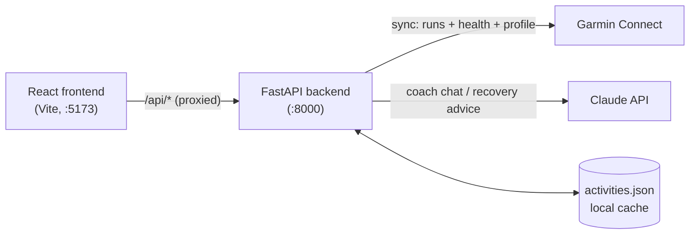

# Marathon AI Coach

A full-stack running dashboard that syncs your runs and recovery metrics from Garmin Connect and uses the Claude API to give training advice grounded in your actual numbers.

## Features

- **Garmin sync** — pulls every running activity plus 30 days of daily health data (HRV, sleep, stress, Body Battery, resting HR, training readiness) in one login, cached locally as JSON.
- **Weekly mileage chart** — last 14 weeks bucketed into Monday–Sunday weeks, with the current week highlighted.
- **Pace analysis** — per-run pace (min/km) in the recent-runs list and a rolling 7-day average pace, plus 7-day / year-to-date distance totals.
- **Today's readiness strip** — latest training readiness, HRV, Body Battery, sleep, resting HR and recovery time at a glance.
- **Recovery Advisor** — Claude weighs 7-day health trends against today's values and recent training, then returns a REST or TRAIN decision with reasoning (`GET /api/recovery`).
- **AI coach chat** — ask anything about your training; Claude sees your last 80 runs (with matching health metrics) and the conversation so far. Chat history persists in the browser.

## Tech Stack

| Layer | Tools |
| --- | --- |
| Frontend | React 18, Vite 5, plain CSS |
| Backend | Python 3.9+, FastAPI, Uvicorn |
| Data source | [`garminconnect`](https://github.com/cyberjunky/python-garminconnect) (unofficial Garmin Connect API) |
| AI | Anthropic Claude API (`anthropic` Python SDK) |
| Storage | Local JSON cache (`backend/data/activities.json`, gitignored) |

## Architecture



- **Sync is the only path that talks to Garmin.** `POST /api/sync` logs in once, fetches activities, 30 days of health snapshots and the profile, then writes everything to a single JSON file. Every other endpoint reads from that cache, so the dashboard loads instantly and doesn't hit Garmin's rate limits.
- **Pure functions do the number crunching.** `dashboard.py` (totals, weekly mileage, latest health), `formatter.py` (runs → compact text for prompts) and `recovery.calculate_health_trends` take plain dicts and return plain dicts, which keeps them easy to test.
- **Claude gets context, not raw JSON.** Runs are formatted into one line each (`[date] name — 10.02km @ 5:12/km | HR 148bpm | HRV 52ms, …`) to keep prompts small and readable. The Recovery Advisor asks Claude to put `REST` or `TRAIN` alone on the first line so the backend can parse it into a badge.
- **The Vite dev server proxies `/api`** to the backend, so the frontend never needs a hard-coded backend URL.

```
backend/
  main.py        FastAPI app and routes
  sync.py        Garmin → activities.json
  garmin.py      Garmin client, activity + health fetching
  dashboard.py   Dashboard aggregation (pure)
  formatter.py   Prompt formatting (pure)
  coach.py       Claude coach chat
  recovery.py    Health trends + Claude REST/TRAIN advice
frontend/src/
  App.jsx        Page layout and data loading
  api.js         Fetch wrappers for the backend
  components/    Header, TodayStrip, CoachPanel, MileageChart, RecentRuns, Sidebar
```

## Setup

### Prerequisites

- Python 3.9+
- Node.js 18+
- A Garmin Connect account
- An Anthropic API key — <https://console.anthropic.com/>

### 1. Environment variables

Create a `.env` file in the repository root:

```bash
GARMIN_EMAIL=you@example.com
GARMIN_PASSWORD=your-garmin-password
ANTHROPIC_API_KEY=sk-ant-...
```

`.env` is gitignored — never commit it.

### 2. Backend

```bash
cd backend
python -m venv venv
source venv/bin/activate        # Windows: venv\Scripts\activate
pip install -r requirements.txt
uvicorn main:app --reload
```

Runs at <http://localhost:8000>. Interactive API docs at <http://localhost:8000/docs>.

### 3. Frontend

```bash
cd frontend
npm install
npm run dev
```

Open <http://localhost:5173> and click **Sync Garmin**.

## API Endpoints

| Method | Path | Description |
| --- | --- | --- |
| `GET` | `/api/status` | Whether synced data exists, activity count, last sync time |
| `POST` | `/api/sync` | Pull runs, 30 days of health data and profile from Garmin |
| `GET` | `/api/dashboard` | Totals, current health snapshot, recent runs, 14-week mileage |
| `GET` | `/api/profile` | Athlete name (fetched from Garmin once, then cached) |
| `GET` | `/api/recovery` | Claude's REST/TRAIN decision, reasoning and 7-day health trends |
| `POST` | `/api/chat` | Ask the coach a question. Body: `{"question": str, "history": [{"role": "user" \| "coach", "content": str}]}` |

## Screenshots

<!-- Replace these placeholders with real screenshots (e.g. docs/screenshots/*.png). -->

| Dashboard | Coach chat |
| --- | --- |
| _TODO: ScreenshotDashboard.png_ | _TODO: coach chat screenshot_ |

| Recovery Advisor | Weekly mileage |
| --- | --- |
| _TODO: recovery screenshot_ | _TODO: mileage chart screenshot_ |

## What I Learned / Design Decisions

- TODO: Why cache Garmin data in a local JSON file instead of calling Garmin on every request
- TODO: How I designed the prompts (compact one-line-per-run format, REST/TRAIN on line 1)
- TODO: Handling missing/partial health data from Garmin
- TODO: Splitting pure logic (dashboard, formatter, trends) from I/O so it can be unit tested
- TODO: Biggest bug I hit and how I debugged it
- TODO: What I'd do next (auth, database, deployment, …)
